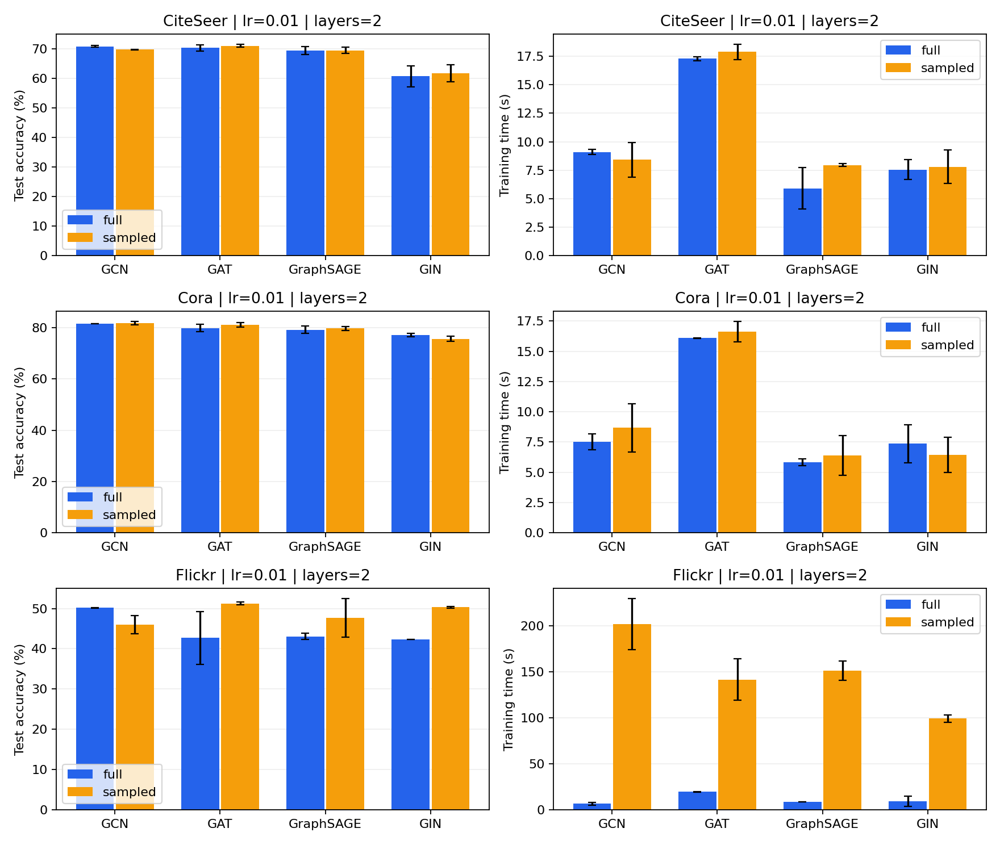
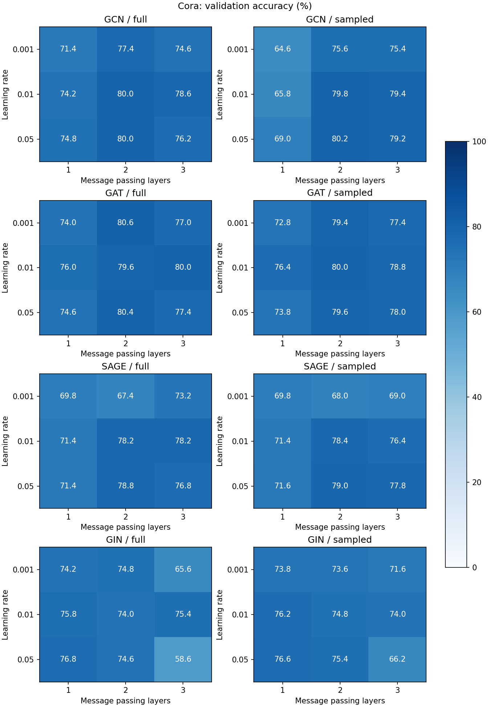

# 任务一实验报告：节点分类

## 1. 实验内容

使用 GCN、GAT、GraphSAGE 和 GIN 完成节点分类，数据集为 Cora、CiteSeer 和 Flickr。训练方式分为全图训练和 `NeighborLoader` 邻居采样训练。

| 模型 | 主要方法 |
|---|---|
| GCN | 使用归一化邻接矩阵聚合邻居特征 |
| GAT | 使用注意力系数加权邻居特征 |
| GraphSAGE | 对邻居特征取均值并与节点自身特征结合 |
| GIN | 对邻居特征求和后使用 MLP 更新节点表示 |

## 2. 数据集

| 数据集 | 节点 | 边 | 特征 | 类别 | 训练 | 验证 | 测试 |
|---|---:|---:|---:|---:|---:|---:|---:|
| Cora | 2,708 | 10,556 | 1,433 | 7 | 140 | 500 | 1,000 |
| CiteSeer | 3,327 | 9,104 | 3,703 | 6 | 120 | 500 | 1,000 |
| Flickr | 89,250 | 899,756 | 500 | 7 | 44,625 | 22,312 | 22,313 |

Cora 和 CiteSeer 使用 public 划分，Flickr 使用数据集自带划分。Flickr 类别分布不均衡，因此同时统计 Accuracy 和 Macro-F1。

## 3. 实验设置

主实验统一使用 2 层网络、隐藏维度 32、dropout 0.5、Adam 优化器、学习率 0.01、权重衰减 5e-4，训练 100 个 epoch。每组实验使用随机种子 42、43、44。

采样训练每层采样 15 个邻居，batch size 为 1024。模型按验证集准确率保存最佳权重，最后在测试集上计算 Accuracy 和 Macro-F1。

参数实验在 Cora 上测试学习率 0.001、0.01、0.05，以及 1、2、3 层网络。运行环境为 PyTorch 2.8.0、PyG 2.7.0 和 NVIDIA GeForce RTX 5080。

## 4. 模型与训练方式对比

结果为 3 个随机种子的均值，Accuracy 后为标准差。

| 数据集 | 模型 | 全图 Accuracy / F1 (%) | 全图时间 (s) | 采样 Accuracy / F1 (%) | 采样时间 (s) |
|---|---|---:|---:|---:|---:|
| Cora | GCN | 81.60 ± 0.00 / 80.48 | 7.50 | 81.77 ± 0.67 / 80.55 | 8.68 |
| Cora | GAT | 79.93 ± 1.45 / 79.71 | 16.10 | 81.17 ± 0.84 / 80.43 | 16.62 |
| Cora | GraphSAGE | 79.27 ± 1.44 / 78.65 | 5.83 | 79.73 ± 0.80 / 78.90 | 6.41 |
| Cora | GIN | 77.20 ± 0.75 / 76.07 | 7.37 | 75.70 ± 0.95 / 74.86 | 6.43 |
| CiteSeer | GCN | 70.90 ± 0.30 / 67.63 | 9.10 | 69.77 ± 0.15 / 66.54 | 8.42 |
| CiteSeer | GAT | 70.37 ± 1.04 / 67.10 | 17.30 | 71.07 ± 0.45 / 67.39 | 17.88 |
| CiteSeer | GraphSAGE | 69.53 ± 1.36 / 66.33 | 5.90 | 69.50 ± 1.08 / 66.09 | 7.95 |
| CiteSeer | GIN | 60.77 ± 3.57 / 57.83 | 7.55 | 61.77 ± 2.95 / 59.36 | 7.79 |
| Flickr | GCN | 50.17 ± 0.11 / 16.56 | 6.60 | 45.98 ± 2.30 / 13.42 | 201.40 |
| Flickr | GAT | 42.71 ± 6.57 / 11.52 | 19.73 | 51.26 ± 0.31 / 20.10 | 141.43 |
| Flickr | GraphSAGE | 43.07 ± 0.74 / 9.56 | 8.71 | 47.69 ± 4.74 / 14.56 | 150.95 |
| Flickr | GIN | 42.34 ± 0.00 / 8.50 | 9.12 | 50.34 ± 0.21 / 23.04 | 98.96 |

Cora 上 GCN 效果最好，CiteSeer 上 GCN 和 GAT 接近。两个小数据集的采样结果与全图结果差距较小。

Flickr 上，采样训练提高了 GAT、GraphSAGE 和 GIN 的准确率，其中 GAT 达到 51.26%。GCN 的采样结果低于全图结果。Flickr 采样训练每个 epoch 包含 44 个 batch，因此耗时高于全图训练。

## 5. 学习率与层数

| 模型 | 训练方式 | 最佳学习率 | 层数 | 验证 Accuracy (%) | 测试 Accuracy (%) |
|---|---|---:|---:|---:|---:|
| GCN | 全图 | 0.01 | 2 | 80.0 | 81.6 |
| GCN | 采样 | 0.05 | 2 | 80.2 | 80.2 |
| GAT | 全图 | 0.001 | 2 | 80.6 | 81.6 |
| GAT | 采样 | 0.01 | 2 | 80.0 | 80.2 |
| GraphSAGE | 全图 | 0.05 | 2 | 78.8 | 79.6 |
| GraphSAGE | 采样 | 0.05 | 2 | 79.0 | 79.6 |
| GIN | 全图 | 0.05 | 1 | 76.8 | 78.3 |
| GIN | 采样 | 0.05 | 1 | 76.6 | 77.8 |

学习率为 0.001、0.01、0.05 时，平均验证准确率分别为 72.96%、76.37%、75.28%。0.01 的整体结果最好，但不同模型的最佳学习率不同。

1、2、3 层网络的平均验证准确率分别为 72.76%、77.07%、74.78%。两层网络整体表现最好；GIN 使用一层时结果更好，三层 GIN 在较大学习率下下降明显。

## 6. 结果文件

主实验结果位于 `results/baseline`，参数实验结果位于 `results/ablation`。训练和测试命令见 `README.md`。
