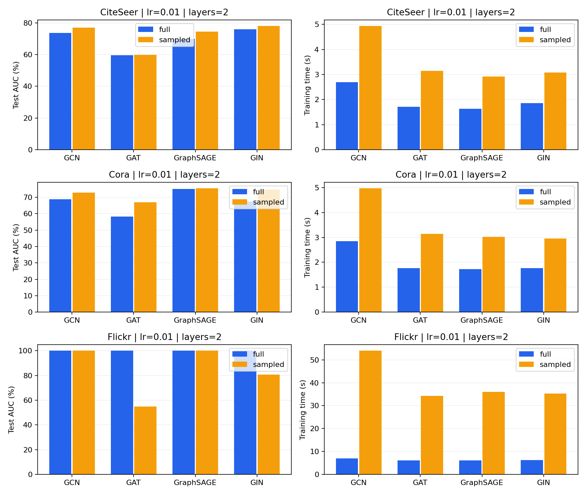
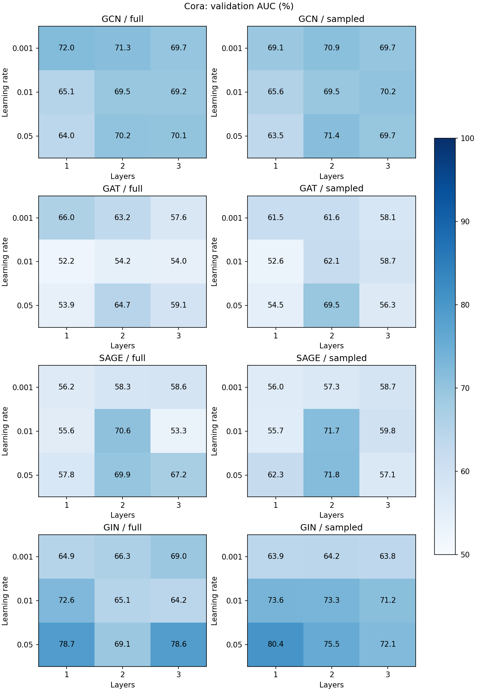

# 任务二实验报告：链路预测

## 1. 实验内容

使用 GCN、GAT、GraphSAGE 和 GIN 编码节点，使用两个节点嵌入的点积预测边是否存在。数据集为 Cora、CiteSeer 和 Flickr。

## 2. 数据与设置

数据边按 85%/5%/10% 划分为训练、验证和测试集。30% 的训练边作为监督边，其余训练边用于消息传递。负样本数量与正样本相同。Flickr 训练时固定抽取 20,000 条正边，全图与采样训练使用相同的监督边。

| 数据集 | 节点 | 无向边 | 训练监督正边 | 验证正边 | 测试正边 |
|---|---:|---:|---:|---:|---:|
| Cora | 2,708 | 5,278 | 1,346 | 263 | 527 |
| CiteSeer | 3,327 | 4,552 | 1,161 | 227 | 455 |
| Flickr | 89,250 | 449,878 | 20,000 | 22,493 | 44,987 |

主实验使用 2 层网络、隐藏维度 32、dropout 0.5、Adam 优化器、学习率 0.01，训练 30 个 epoch。采样训练使用 `LinkNeighborLoader`，每层采样 15 个邻居，batch size 为 2048。

## 3. 模型与训练方式对比

| 数据集 | 模型 | 全图 AUC / AP (%) | 全图时间 (s) | 采样 AUC / AP (%) | 采样时间 (s) |
|---|---|---:|---:|---:|---:|
| Cora | GCN | 68.91 / 71.27 | 2.84 | 72.93 / 73.90 | 4.97 |
| Cora | GAT | 58.25 / 59.80 | 1.77 | 67.03 / 64.93 | 3.14 |
| Cora | GraphSAGE | 75.01 / 70.99 | 1.72 | 75.45 / 71.27 | 3.02 |
| Cora | GIN | 67.29 / 71.09 | 1.76 | 74.70 / 76.16 | 2.95 |
| CiteSeer | GCN | 73.68 / 76.23 | 2.70 | 77.01 / 77.93 | 4.93 |
| CiteSeer | GAT | 59.68 / 66.15 | 1.71 | 59.89 / 65.84 | 3.15 |
| CiteSeer | GraphSAGE | 69.77 / 73.04 | 1.63 | 74.55 / 74.87 | 2.92 |
| CiteSeer | GIN | 76.04 / 78.14 | 1.86 | 77.98 / 79.59 | 3.08 |
| Flickr | GCN | 99.98 / 99.90 | 6.97 | 99.96 / 99.81 | 53.98 |
| Flickr | GAT | 100.00 / 100.00 | 6.12 | 54.97 / 51.59 | 34.27 |
| Flickr | GraphSAGE | 100.00 / 100.00 | 6.18 | 100.00 / 100.00 | 36.01 |
| Flickr | GIN | 100.00 / 100.00 | 6.22 | 80.68 / 83.06 | 35.25 |

Cora 和 CiteSeer 上，采样训练提高了大部分模型的 AUC。Cora 采样 GIN 从 67.29% 提升到 74.70%，CiteSeer 采样 GraphSAGE 从 69.77% 提升到 74.55%。

Flickr 使用随机负边，完整图编码较容易区分正负边。GCN 和 GraphSAGE 在两种方式下都取得较高 AUC，GAT 和 GIN 对邻居采样更敏感。采样训练需要构造多个子图，因此运行时间高于全图训练。

## 4. 学习率与层数

在 Cora 上测试学习率 0.001、0.01、0.05，以及 1、2、3 层网络。

| 模型 | 训练方式 | 最佳学习率 | 层数 | 验证 AUC (%) | 测试 AUC (%) |
|---|---|---:|---:|---:|---:|
| GCN | 全图 | 0.001 | 1 | 71.99 | 72.32 |
| GCN | 采样 | 0.05 | 2 | 71.36 | 74.26 |
| GAT | 全图 | 0.001 | 1 | 66.05 | 70.68 |
| GAT | 采样 | 0.05 | 2 | 69.47 | 69.12 |
| GraphSAGE | 全图 | 0.01 | 2 | 70.58 | 75.01 |
| GraphSAGE | 采样 | 0.05 | 2 | 71.78 | 73.64 |
| GIN | 全图 | 0.05 | 1 | 78.74 | 81.06 |
| GIN | 采样 | 0.05 | 1 | 80.43 | 81.08 |

学习率 0.001、0.01、0.05 的平均验证 AUC 分别为 63.67%、63.74%、66.97%，0.05 的整体结果最好。

1、2、3 层网络的平均验证 AUC 分别为 63.24%、67.13%、64.01%。两层网络整体表现最好，GIN 使用一层时效果更好。

## 5. 结果文件

主实验结果位于 `results/baseline`，参数实验结果位于 `results/ablation`。
