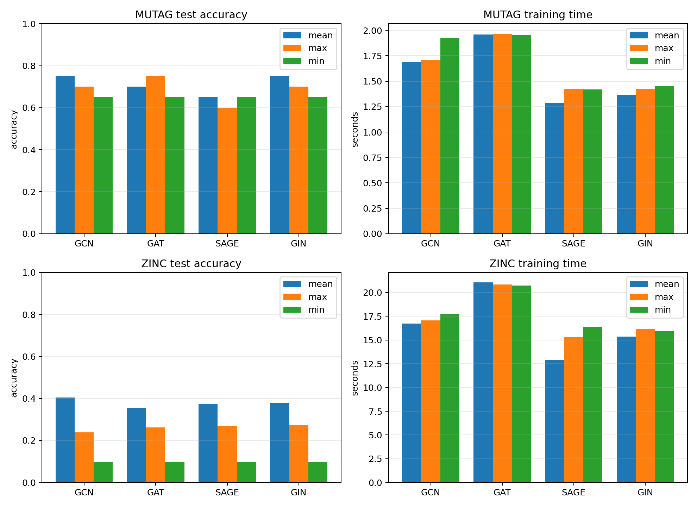
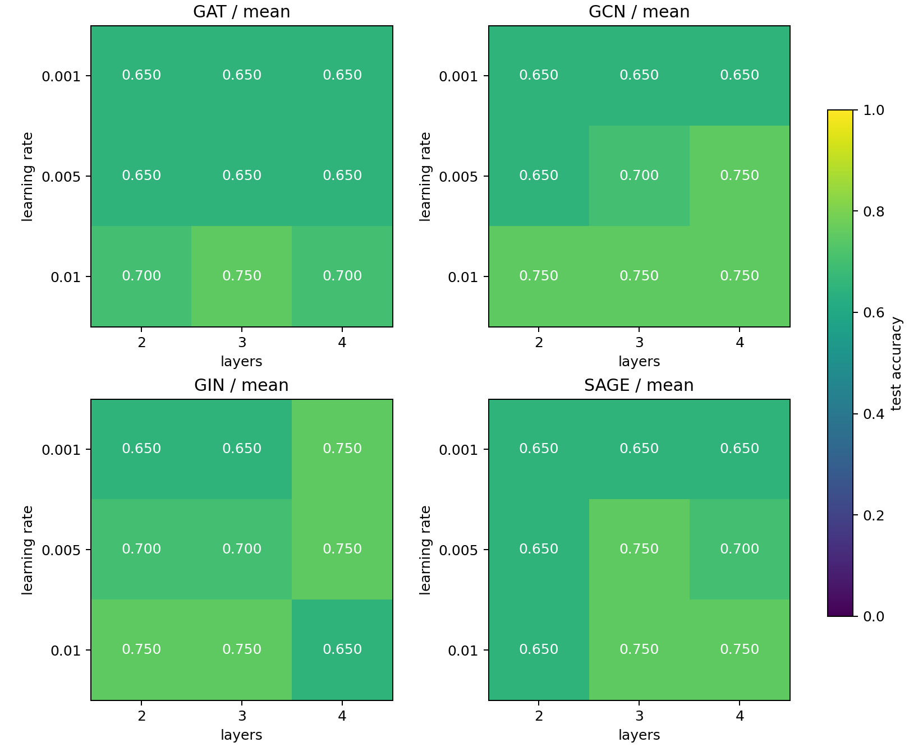
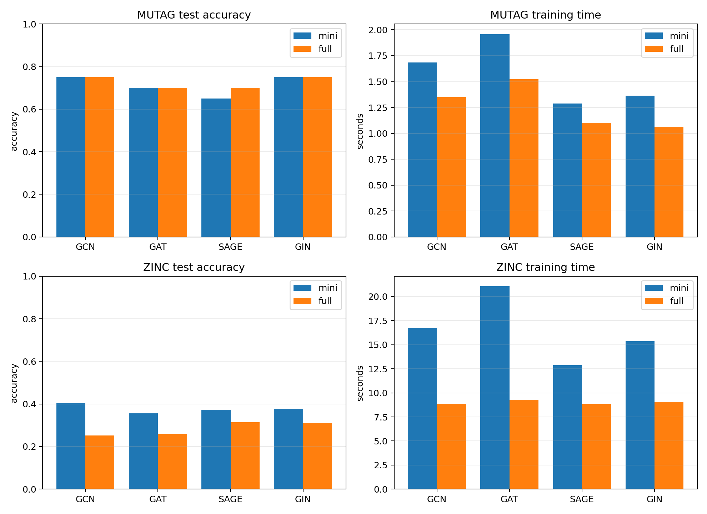

# 任务三实验报告

## 实验设置

模型统一使用 64 维隐藏层、Adam 优化器和交叉熵损失，训练 30 轮。基准实验的学习率为 0.01，网络层数为 2，随机种子为 42。以验证集准确率选择最优模型。

MUTAG 按类别分层划分为 150 个训练图、18 个验证图和 20 个测试图。ZINC 使用官方划分，并按训练集目标的十分位点转为 10 类；基准实验使用 3000 个训练图、1000 个验证图和 1000 个测试图。

## 模型与池化方式

表中格式为“测试准确率 / Macro-F1”。

| 数据集 | 模型 | mean | max | min |
| --- | --- | ---: | ---: | ---: |
| MUTAG | GCN | 0.750 / 0.642 | 0.700 / 0.670 | 0.650 / 0.394 |
| MUTAG | GAT | 0.700 / 0.670 | 0.750 / 0.642 | 0.650 / 0.394 |
| MUTAG | GraphSAGE | 0.650 / 0.561 | 0.600 / 0.560 | 0.650 / 0.394 |
| MUTAG | GIN | 0.750 / 0.733 | 0.700 / 0.643 | 0.650 / 0.394 |
| ZINC | GCN | 0.404 / 0.344 | 0.239 / 0.187 | 0.097 / 0.018 |
| ZINC | GAT | 0.356 / 0.280 | 0.262 / 0.171 | 0.097 / 0.018 |
| ZINC | GraphSAGE | 0.372 / 0.304 | 0.268 / 0.178 | 0.097 / 0.018 |
| ZINC | GIN | 0.377 / 0.296 | 0.274 / 0.205 | 0.097 / 0.018 |

MUTAG 上 mean、max、min 的模型平均准确率分别为 0.713、0.688、0.650。ZINC 上分别为 0.377、0.261、0.097，mean 池化优势最明显。MUTAG 的最高准确率为 0.750；其中 GIN+mean 的 Macro-F1 最高，为 0.733。ZINC 的最佳组合是 GCN+mean，准确率为 0.404。

## 学习率与网络层数

参数实验固定 MUTAG 和 mean 池化，测试 3 个学习率与 3 种层数。不同模型的最佳结果如下。

| 模型 | 学习率 | 层数 | 测试准确率 | Macro-F1 |
| --- | ---: | ---: | ---: | ---: |
| GCN | 0.01 | 4 | 0.750 | 0.642 |
| GAT | 0.01 | 3 | 0.750 | 0.733 |
| GraphSAGE | 0.01 | 4 | 0.750 | 0.733 |
| GIN | 0.01 | 3 | 0.750 | 0.733 |

按全部模型和层数求平均，学习率 0.001、0.005、0.01 的准确率分别为 0.658、0.692、0.725。学习率 0.01 在 30 轮训练下整体最好。2、3、4 层的平均准确率分别为 0.675、0.700、0.700；增加到 3 层有效，继续增加到 4 层没有整体提升。GIN 在 4 层、学习率 0.01 时降至 0.650，说明更深的网络并不总是更好。

## 全批次与分批训练

固定 mean 池化，将 batch size=128 的分批训练与全部训练图一次输入的全批次训练比较。

| 数据集 | 模型 | 分批准确率 | 全批准确率 | 分批时间(s) | 全批时间(s) |
| --- | --- | ---: | ---: | ---: | ---: |
| MUTAG | GCN | 0.750 | 0.750 | 1.68 | 1.35 |
| MUTAG | GAT | 0.700 | 0.700 | 1.96 | 1.52 |
| MUTAG | GraphSAGE | 0.650 | 0.700 | 1.29 | 1.10 |
| MUTAG | GIN | 0.750 | 0.750 | 1.36 | 1.06 |
| ZINC | GCN | 0.404 | 0.252 | 16.72 | 8.87 |
| ZINC | GAT | 0.356 | 0.259 | 21.07 | 9.27 |
| ZINC | GraphSAGE | 0.372 | 0.314 | 12.87 | 8.85 |
| ZINC | GIN | 0.377 | 0.310 | 15.37 | 9.07 |

MUTAG 的两种方式差异较小：平均准确率分别为 0.713 和 0.725。ZINC 分批训练的平均准确率为 0.377，高于全批次的 0.284；全批次平均训练时间为 9.02 秒，分批训练为 16.51 秒。全批次每轮只有一次参数更新，所以运行更快，但在相同 30 轮下学习不充分。

## 结论

本实验中 mean 池化最稳定，min 池化在 ZINC 上退化到接近随机分类。MUTAG 的较好设置集中在学习率 0.01、3 至 4 层。模型方面，MUTAG 上 GIN+mean 的类别均衡性最好，ZINC 上 GCN+mean 的准确率最高。分批训练在 ZINC 上效果更好，全批次训练耗时更少。MUTAG 测试集只有 20 个图，因此其准确率每次变化 0.05，结论以本次固定划分为准。
