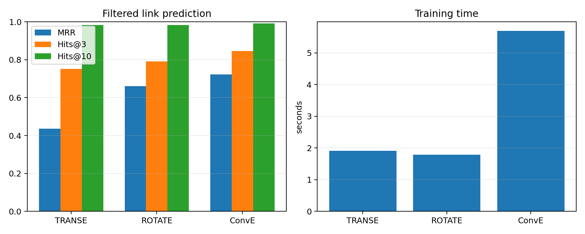
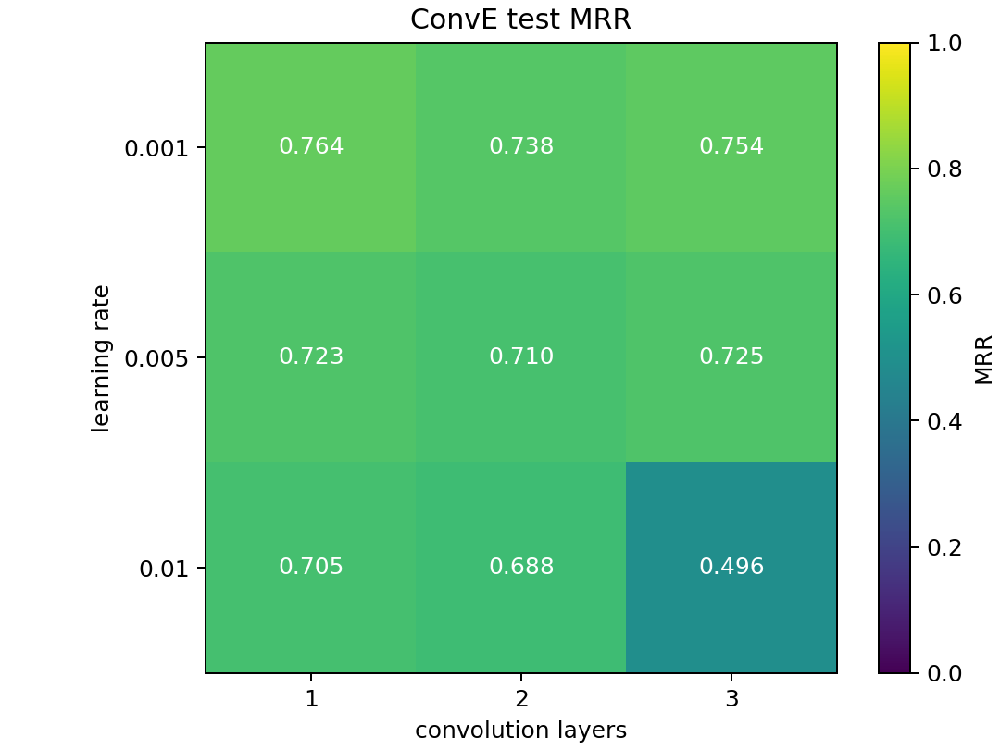

# 任务四实验报告

## 模型原理

- TransE 将关系表示为实体之间的平移，目标是让正确三元组满足 `h + r ≈ t`。
- RotatE 在复数空间中将关系表示为旋转，能够表达对称、反对称、逆关系和关系组合。
- ConvE 将头实体与关系嵌入重排后进行二维卷积，再与尾实体嵌入计算得分。

## 数据与评估

Nations 数据集包含 14 个实体和 55 种关系，训练集、验证集、测试集分别有 1592、199、201 条三元组。训练时加入反向关系，使头实体预测也能按尾实体预测处理。测试同时预测头实体和尾实体，并使用过滤排名计算 MRR、MR 和 Hits@1/3/10。

基准实验使用 64 维嵌入、学习率 0.005、batch size 256、每个正样本 16 个负样本，训练 100 轮。随机种子为 42，运行设备为 CPU，以验证集 MRR 选择最优轮次。

## 模型结果

| 模型 | MRR | MR | Hits@1 | Hits@3 | Hits@10 | 参数量 | 训练时间(s) |
| --- | ---: | ---: | ---: | ---: | ---: | ---: | ---: |
| TransE | 0.4369 | 3.1144 | 0.0697 | 0.7512 | 0.9826 | 7,936 | 1.91 |
| RotatE | 0.6601 | 2.5100 | 0.4851 | 0.7910 | 0.9826 | 8,832 | 1.79 |
| ConvE | 0.7231 | 2.1617 | 0.5746 | 0.8458 | 0.9925 | 139,278 | 5.69 |

ConvE 的 MRR 和 Hits@1/3/10 均最高，但参数量和训练时间也最多。RotatE 的 MRR 比 TransE 高 0.2232，说明复数旋转比简单平移更适合 Nations 中的多种关系模式。TransE 的 Hits@10 较高，但 Hits@1 只有 0.0697，正确实体通常能进入前十，却很少排在首位。

## 学习率与卷积层数

固定 64 维嵌入，对 ConvE 测试三个学习率和一至三层卷积。

| 学习率 | 1层 | 2层 | 3层 |
| ---: | ---: | ---: | ---: |
| 0.001 | **0.7639** | 0.7380 | 0.7536 |
| 0.005 | 0.7231 | 0.7096 | 0.7252 |
| 0.01 | 0.7053 | 0.6882 | 0.4959 |

表中数值为测试 MRR。三个学习率的平均 MRR 分别为 0.7518、0.7193、0.6298，0.001 整体最好。一、二、三层的平均 MRR 分别为 0.7308、0.7120、0.6582，增加卷积层数没有带来稳定提升。学习率 0.01 与三层卷积组合的 MRR 降至 0.4959，训练曲线也表明该组合收敛较差。

## 结论

Nations 上表现最好的设置是 ConvE、学习率 0.001、单层卷积，测试 MRR 为 0.7639。RotatE 在参数量接近 TransE 的情况下明显更好。ConvE 能取得最高精度，但该小型数据集不需要更深的卷积结构，单层模型的效果和运行效率更合适。

## 参考资料

- [参考 KGE 框架](https://github.com/Maxioo/kge_framework)
- [TransE](https://papers.neurips.cc/paper/5071-translating-embeddings-for-modeling-multi-relational-data)
- [RotatE](https://openreview.net/forum?id=HkgEQnRqYQ)
- [ConvE](https://arxiv.org/abs/1707.01476)
