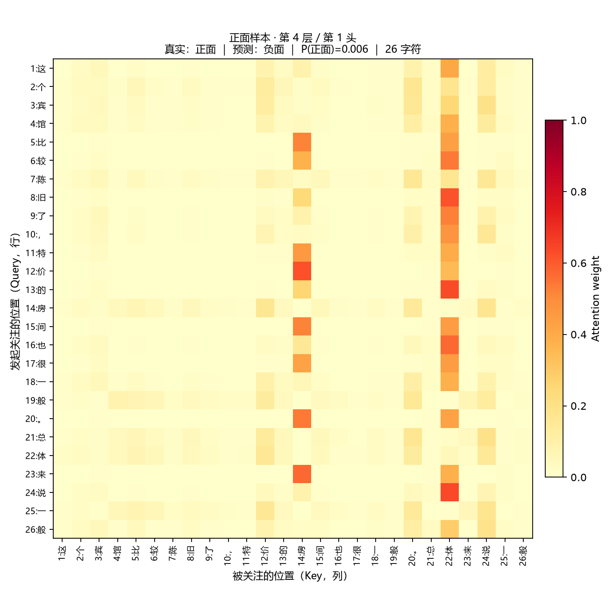
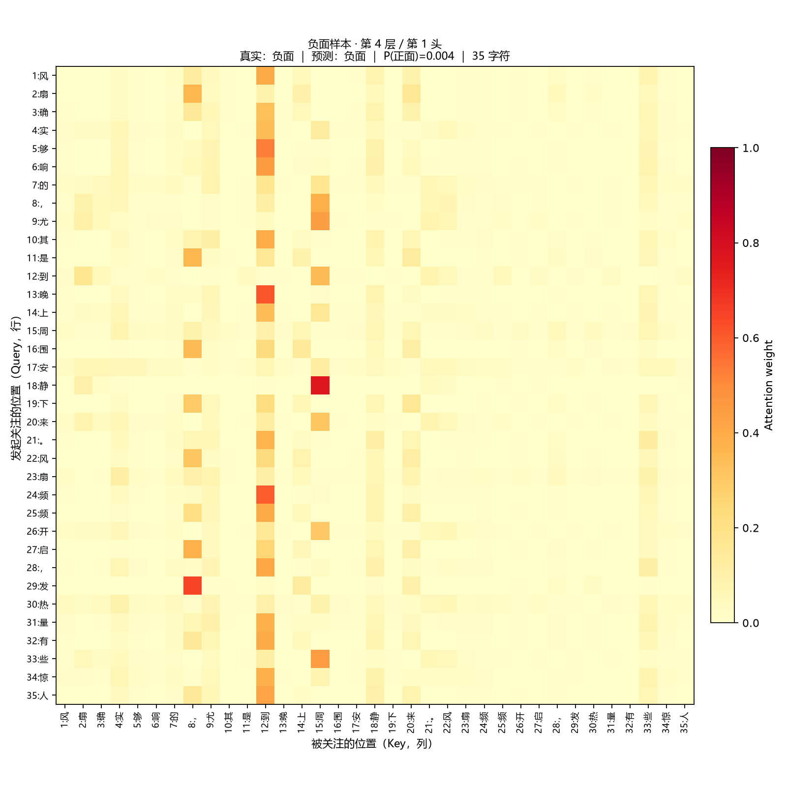
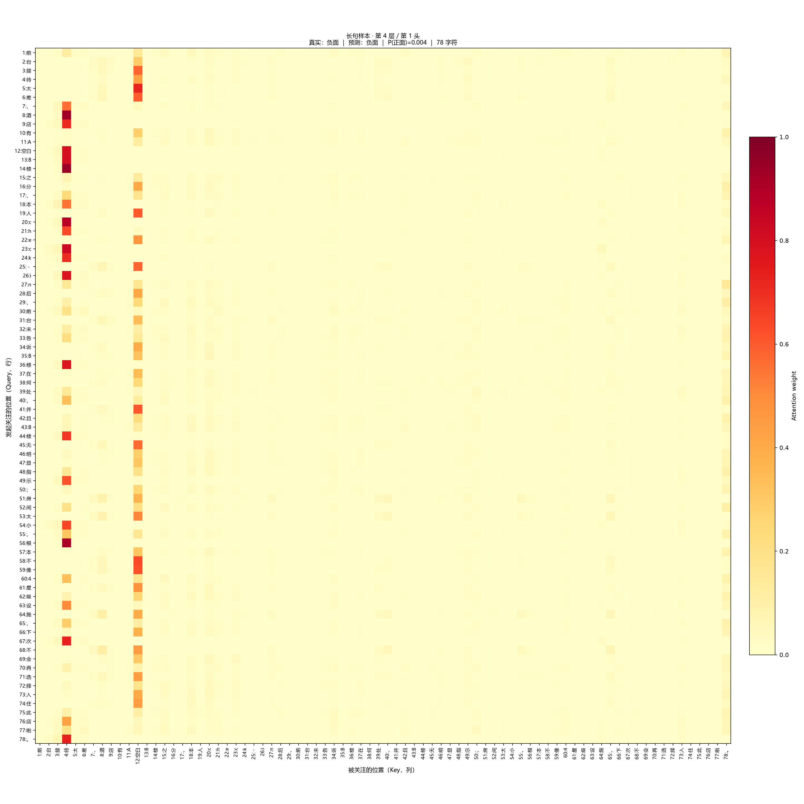
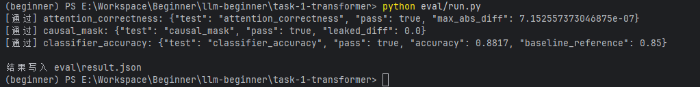

# M5 注意力观察

使用 M3 最佳模型，在测试集中按固定长度和标签规则选取三条样本，未按预测结果筛选。统一展示第 4 层、第 1 头，色标固定为 0–1。横轴是 Key，纵轴是 Query，序号从 1 开始；每一行权重之和为 1。

正面样本共26字符，预测错误。按所有 Query 的平均关注权重，最受关注的位置为第22位'体'（0.347）、第14位'房'（0.198）、第24位'说'（0.087）。

负面样本共35字符，预测正确。按所有 Query 的平均关注权重，最受关注的位置为第12位'到'（0.258）、第8位'，'（0.116）、第15位'周'（0.111）。

长句样本共78字符，预测正确。按所有 Query 的平均关注权重，最受关注的位置为第4位'待'（0.244）、第12位' '（0.236）、第78位'。'（0.046）。

上述统计仅描述一个头的信息聚合，不能据此断言这些字符造成了分类结果。分类器使用双向注意力，所以对角线右上方有权重是正常现象，与 M4 的因果模型不同。长句每行要向更多位置分配权重，颜色偏浅不等于模型更不确定；完整判断还需比较其他层和头，并结合遮挡实验。

## 样本与图片

### 正面样本

这个宾馆比较陈旧了，特价的房间也很一般。总体来说一般

### 负面样本

风扇确实够响的，尤其是到晚上周围安静下来。风扇频频开启，发热量有些惊人

### 长句样本

前台接待太差，酒店有A B楼之分，本人check－in后，前台未告诉B楼在何处，并且B楼无明显指示；房间太小，根本不像4星级设施，下次不会再选择入住此店啦。

自检全部通过

