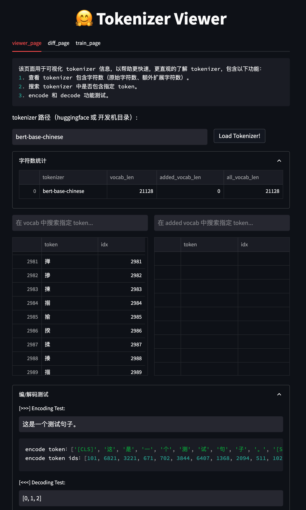

# Tokenizer Viewer

任务 9 的工具：查看 Hugging Face tokenizer 的基础词表、额外 token 和总词数；搜索 token；测试编码、解码；比较两个 tokenizer 的独有 token 与相同 token 的 ID 差异。界面和命令行共用同一套处理逻辑。默认不执行远程 tokenizer 自定义代码。

## 环境与启动

需要 Python 3.10+、`transformers`、`streamlit`，以及所选 tokenizer 自身需要的依赖。部分模型还需要 `sentencepiece` 等额外包。模型 ID 首次加载需要联网；本地目录可离线加载。

在仓库根目录运行：

```powershell
python -m pip install transformers streamlit
python -m streamlit run tools/tokenizer_viewer/web_ui.py --server.port 8001
```

也可使用 `tools/tokenizer_viewer/start.ps1`（PowerShell）或 `tools/tokenizer_viewer/start.sh`（POSIX shell），第一个参数可指定端口，默认 8001。打开页面后填入本地 tokenizer 目录或 Hugging Face 模型 ID，点击加载。词表按 ID 排序，页面每类最多显示 1000 条；搜索会在全部词表中匹配，避免一次渲染超大表。解码输入必须是 JSON 整数数组，例如 `[108386, 3837, 99489, 6313]`。

## 命令行

以下示例使用本项目任务 7/8 下载的本地 Qwen tokenizer；可替换为其他目录或 Hugging Face 模型 ID。

```powershell
python tools/tokenizer_viewer/cli.py inspect LLM/models/Qwen2.5-0.5B --token '<|im_start|>' --limit 10
python tools/tokenizer_viewer/cli.py encode LLM/models/Qwen2.5-0.5B '你好，世界！'
python tools/tokenizer_viewer/cli.py decode LLM/models/Qwen2.5-0.5B '[108386, 3837, 99489, 6313]'
python tools/tokenizer_viewer/cli.py compare LLM/models/Qwen2.5-0.5B answer_generation/models/t5-small-chinese-cluecorpussmall --limit 10
```

输出为 JSON。`compare` 总是返回完整的差异数量，仅展示每类前 `--limit` 条结果；设为 `0` 可只看数量。比较基于 token 字符串和 ID，不意味着两个 tokenizer 的分词算法可互换。词表合并与训练尚未实现，原项目也未将其标为已完成能力。

## 验证

```powershell
python -m unittest discover -s tools/tokenizer_viewer -p 'test_*.py' -v
```

单元测试覆盖安全解析、差异排序与 ID 变化；如果本地 Qwen 和 T5 目录存在，还会通过 Streamlit AppTest 验证页面。实测数据与结果见 [实验报告](实验报告.md)。


